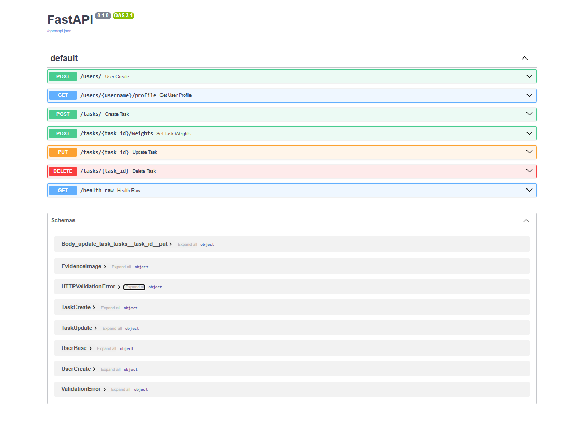

# Task & Model Hub API (FastAPI)

[🇹🇷 Türkçe](#-türkçe) | [🇬🇧 English](#-english)

---

## 🇬🇧 English

A RESTful **AI & Field Task Management API** built with **FastAPI** and **Pydantic v2**, designed to practice schema validation, nested models, response filtering, custom HTTP status codes, and interactive Swagger UI (`openapi_examples`) documentation.

### Preview (Swagger UI)



### Key Features

* **User Management & Response Filtering:** Password masking via `response_model=UserBase` on creation (`201 Created`) and unset-field exclusion (`response_model_exclude_unset=True`) on case-insensitive profile lookups.
* **Nested Schema & Field Validation:** Strict input constraints using `Field` (`min_length`, `max_length`, `gt`, `ge`, `le`), `EmailStr`, `HttpUrl`, unique `set[str]` tags, and nested `EvidenceImage` lists.
* **Interactive OpenAPI Examples:** Pre-configured request payloads (`normal_gorev` and `kritik_ariza`) inside Swagger UI via `Annotated` and `Body(openapi_examples=...)`.
* **Task Weights & Dry-Run Updates:** Dynamic `dict[int, float]` weight assignment and partial task updates (`Body(embed=True)` + `exclude_unset=True`) with `dry_run` preview mode.
* **Custom Status Codes & Raw Responses:** `204 No Content` deletion and dual-mode (`JSONResponse` vs. `dict`) health check endpoint.

### API Endpoints

| Method | Endpoint | Description | Status Code |
| :--- | :--- | :--- | :--- |
| `POST` | `/users/` | Register a new user (hides `password` in response) | `201 Created` |
| `GET` | `/users/{username}/profile` | Fetch user profile (returns fallback if not found) | `200 OK` |
| `POST` | `/tasks/` | Create a field/AI task with OpenAPI examples | `201 Created` |
| `POST` | `/tasks/{task_id}/weights` | Attach model/priority weights (`dict[int, float]`) | `200 OK` |
| `PUT` | `/tasks/{task_id}` | Partially update a task with optional `dry_run` preview | `200 OK` |
| `DELETE` | `/tasks/{task_id}` | Delete a task by ID | `204 No Content` |
| `GET` | `/health-raw` | Health check returning raw `JSONResponse` or `dict` | `200 OK` |

### Tech Stack

* **Framework:** FastAPI
* **Validation:** Pydantic v2 (`BaseModel`, `Field`, `EmailStr`, `HttpUrl`)
* **Server:** Uvicorn
* **Storage:** In-memory Python dictionaries (`users_db`, `tasks_db`)

### Installation & Running Locally

```bash
# 1. Clone the repository
git clone [https://github.com/mali21ezgin/Task-And-Model-Hub-API.git](https://github.com/mali21ezgin/Task-And-Model-Hub-API.git)
cd Task-And-Model-Hub-API

# 2. Create and activate a virtual environment
python -m venv .venv
# Windows:
.venv\Scripts\activate
# Linux / macOS:
source .venv/bin/activate

# 3. Install dependencies
pip install fastapi uvicorn "pydantic[email]"

# 4. Run the development server
uvicorn main:app --reload
```

Open Swagger UI in your browser: `http://127.0.0.1:8000/docs`

---

## 🇹🇷 Türkçe

**FastAPI** ve **Pydantic v2** kullanılarak geliştirilmiş; şema doğrulama, iç içe modeller, yanıt filtreleme, özel HTTP durum kodları ve etkileşimli Swagger UI (`openapi_examples`) dokümantasyonunu pratik etmek amacıyla tasarlanmış bir **AI ve Saha Görev Yönetimi API** projesidir.

### Önizleme (Swagger UI)


### Temel Özellikler

* **Kullanıcı Yönetimi ve Yanıt Filtreleme:** Kayıt oluştururken (`201 Created`) `response_model=UserBase` ile şifreyi yanıtta gizleme ve büyük/küçük harf duyarsız profil sorgularında `response_model_exclude_unset=True` ile gönderilmeyen alanları ayıklama.
* **İç İçe Şema ve Alan Doğrulama:** `Field` (`min_length`, `max_length`, `gt`, `ge`, `le`), `EmailStr`, `HttpUrl`, benzersiz `set[str]` etiketleri ve iç içe `EvidenceImage` listeleri ile veri doğrulama.
* **Etkileşimli OpenAPI Örnekleri:** `Annotated` ve `Body(openapi_examples=...)` kullanarak Swagger UI üzerinde hazır istek gövdeleri (`normal_gorev` ve `kritik_ariza`) sunma.
* **Görev Ağırlıkları ve `dry_run` Güncelleme:** `dict[int, float]` tipinde dinamik ağırlık atama ve `Body(embed=True)` + `exclude_unset=True` ile `dry_run` önizleme destekli kısmi görev güncelleme.
* **Özel Durum Kodları ve Ham Yanıtlar:** `204 No Content` ile silme işlemi ve `raw_mode` parametresine göre `JSONResponse` veya `dict` döndüren sağlık kontrolü endpoint'i.

### API Uç Noktaları (Endpoints)

| Metot | Endpoint | Açıklama | Durum Kodu |
| :--- | :--- | :--- | :--- |
| `POST` | `/users/` | Yeni kullanıcı oluşturur (`password` alanını gizler) | `201 Created` |
| `GET` | `/users/{username}/profile` | Kullanıcı profilini getirir (yoksa varsayılan döner) | `200 OK` |
| `POST` | `/tasks/` | OpenAPI örnekleriyle yeni saha/AI görevi oluşturur | `201 Created` |
| `POST` | `/tasks/{task_id}/weights` | Göreve ağırlık sözlüğü (`dict[int, float]`) ekler | `200 OK` |
| `PUT` | `/tasks/{task_id}` | `dry_run` önizleme seçeneğiyle görevi kısmen günceller | `200 OK` |
| `DELETE` | `/tasks/{task_id}` | ID'ye göre görevi siler | `204 No Content` |
| `GET` | `/health-raw` | `JSONResponse` veya `dict` olarak servis durumunu döner | `200 OK` |

### Kullanılan Teknolojiler

* **Framework:** FastAPI
* **Veri Doğrulama:** Pydantic v2 (`BaseModel`, `Field`, `EmailStr`, `HttpUrl`)
* **Sunucu:** Uvicorn
* **Veri Saklama:** Bellek içi Python sözlükleri (`users_db`, `tasks_db`)

### Kurulum ve Çalıştırma

```bash
# 1. Repoyu klonlayın
git clone [https://github.com/mali21ezgin/Task-And-Model-Hub-API.git](https://github.com/mali21ezgin/Task-And-Model-Hub-API.git)
cd Task-And-Model-Hub-API

# 2. Sanal ortam oluşturun ve aktif edin
python -m venv .venv
# Windows:
.venv\Scripts\activate
# Linux / macOS:
source .venv/bin/activate

# 3. Gerekli paketleri kurun
pip install fastapi uvicorn "pydantic[email]"

# 4. Sunucuyu başlatın
uvicorn main:app --reload
```

Tarayıcıda Swagger UI arayüzünü açın: `http://127.0.0.1:8000/docs`